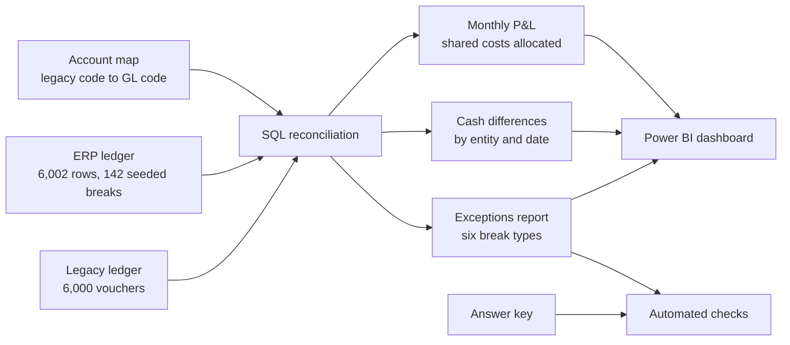

# Ledger reconciliation and reporting pipeline

Reconciles a legacy ledger against a new ERP ledger after a system migration, explains every difference, and produces the tables behind a Power BI dashboard. Built in SQL and base R on synthetic data for a fictional three-entity group.

**Author:** Ashaaz Jeelani

## Why this exists

When a business moves from one accounting system to another, the two sets of books rarely agree on day one. Someone has to find out which entries are missing, which were posted twice, which landed on the wrong date or the wrong account, and what that does to the cash position and the P&L. This project automates that work and proves the result is right.

## How it works



1. `R/01_generate_data.R` writes the two ledgers and plants 142 breaks of six kinds in the ERP copy. It also writes an answer key.
2. `sql/02_reconcile.sql` matches every voucher and labels it.
3. `sql/03_daily_cash.sql` compares cash movement per entity per day and lists the days that disagree.
4. `sql/04_pnl_allocation.sql` builds the monthly P&L and allocates shared service costs to the trading entities by share of revenue.
5. `R/02_checks.R` tests the SQL output against the answer key.

## Results

| Status | Lines | What it means |
|---|---|---|
| Matched | 5,873 | Same amount, date and account in both systems |
| Timing difference | 40 | Posted one to three days late in the ERP |
| Amount mismatch | 30 | Amount keyed differently in the ERP |
| Missing in ERP | 25 | Voucher never migrated |
| Account mismapped | 20 | Posted to the wrong general ledger account |
| Missing in legacy | 15 | Exists only in the ERP |
| Duplicate in ERP | 12 | Posted twice |

The match rate is 97.6% (5,873 of 6,015 lines). All 142 planted breaks are found and labelled correctly, with no false alarms. Rupee values are in `output/recon_summary.csv`.

## Checks

Every run ends with three tests, and the run fails if any of them does:

1. Every seeded break is found with the right label, and nothing else is flagged.
2. Every legacy voucher appears exactly once in the reconciliation.
3. Shared costs allocated out equal the shared cost pool in each month.

## Run it

Requires R and SQLite.

```bash
bash run.sh
```

GitHub runs the same script on every push (see the Actions tab), so the results in `output/` can be reproduced by anyone.

## Folder guide

| Path | Contents |
|---|---|
| `R/` | Data generator and checks, base R only |
| `sql/` | Schema, reconciliation, cash and P&L queries |
| `data/` | The two ledgers, the account map and the answer key |
| `output/` | Result tables, ready for Power BI |
| `powerbi/BUILD_GUIDE.md` | Steps to build the dashboard from `output/` |
| `docs/WALKTHROUGH.md` | What each query does and why |

## Notes

All data is synthetic and generated by the script in this repository. No client or employer data is used.
